# Sistema de Gestión de Identidad Digital (SGID)

SGID es el sistema donde el ciudadano inicia sesión para todo el Estado. Se
registra una vez, verifica su identidad con dos factores que elige entre tres
(contraseña, código al teléfono o rostro) y los servicios públicos, como una alcaldía o un
hospital, lo usan como su forma de autenticación con **"Iniciar sesión con
SGID"**. Así ningún servicio tiene que construir su propio login.

## Ejecutar

```bash
npm install
copy .env.example .env   # en bash: cp .env.example .env
npm run web              # abre http://localhost:3000
```

| Comando | Qué hace |
|---|---|
| `npm test` | Corre las 42 pruebas |
| `npm start` | Demo por consola de los patrones, con datos fijos |
| `npm run demo` | Demo interactiva por consola |
| `npm run datos:borrar` | Borra usuarios, roles, servicios y auditoría (vuelve al primer arranque) |

La primera persona que se registra queda como administrador. El rostro
necesita cámara e internet; con cámara real funciona bien
`BIOMETRIA_UMBRAL=0.5`, que ya viene en `.env.example`.

Para entrar, la persona escribe su documento y elige su primer método
(rostro, contraseña o código SMS); al superarlo, elige un segundo método
distinto y entra. En el pie de página, **Ver patrones de diseño** muestra qué
patrón usa cada parte de la pantalla (útil para presentar); apagado, la
interfaz queda limpia.

## Qué cumple

| Requisito | Cómo se cumple |
|---|---|
| Autenticación biométrica multifactor | La persona elige 2 de 3 factores (contraseña, código SMS, rostro), con límite de 3 intentos por factor |
| Gestión de permisos y roles | Roles armados como un árbol de permisos, editables desde el panel de administración |
| Integración con servicios gubernamentales | Los servicios se conectan a SGID y lo usan para iniciar sesión (OAuth2) |
| Estándares de seguridad | Contraseñas con hash, datos sensibles cifrados, tokens firmados y auditoría encadenada |

## Actores

| Actor | Rol |
|---|---|
| Ciudadano | Se registra, inicia sesión y consulta su identidad |
| Administrador | Gestiona roles, permisos, usuarios y servicios conectados, y revisa la auditoría |
| Servicio del Estado | Portal o trámite que usa SGID para iniciar sesión |

## Arquitectura

Se usa arquitectura **hexagonal (puertos y adaptadores)**: la lógica de
negocio no depende de cómo se guardan los datos ni de qué proveedor envía los
SMS, así esas piezas se pueden cambiar sin tocar las reglas.

```
src/
├── domain/          # Entidades y reglas de negocio
├── application/     # Casos de uso
├── infrastructure/  # Adaptadores: archivos JSON, criptografía, SMS, auditoría
└── web/             # API REST (Express)
public/              # Interfaz web
```

**Tecnologías:** TypeScript, Node.js 20.12+, Express, Jest, face-api.js
(rostro en el navegador) y el módulo `crypto` de Node. Los datos se guardan
en archivos JSON dentro de `data/`.

## Patrones de diseño

| Etapa | Patrón | Para qué se usó | Carpeta |
|---|---|---|---|
| 2 | Singleton | Una sola configuración para todo el sistema | `infrastructure/config` |
| 3 | Factory Method | Los tres factores de autenticación | `application/auth` |
| 4 | Builder | Armar la credencial digital paso a paso | `application/credencial` |
| 5 | Adapter | Enviar SMS con dos proveedores distintos | `infrastructure/notificaciones` |
| 6 | Bridge | Separar el tipo de aviso del canal de envío | `application/notificaciones` |
| 7 | Composite | Permisos agrupados en árbol | `domain/permisos` |
| 8 | Decorator | Bitácora, auditoría y límite de intentos | `application/auth` |
| 9 | Flyweight | Compartir los tipos de documento | `domain/documentos` |
| 10 | Proxy | Proteger el acceso a los datos de identidad | `application/identidad` |
| 11 | *(los mismos)* | Iniciar sesión con SGID, seguridad y panel de administración | `application/`, `web/` |
| 12 | Strategy | Regla de contraseña distinta según el rol | `application/usuarios` |
| 13 | Template Method | Exportar la auditoría en JSON o CSV con el mismo procedimiento | `application/auditoria` |

---

## ETAPA 2 — Singleton

**Qué es:** asegura que una clase tenga una sola instancia y un único punto de acceso.

**En el proyecto:** `ConfigManager` lee la configuración (puerto, secretos,
umbral facial) una sola vez y todo el sistema la pide con
`ConfigManager.getInstance()`. Así nadie trabaja con valores distintos.

**Archivos:** `infrastructure/config/config-manager.ts`, `application/auth/verificador-biometrico.ts`

**Pruebas:** `tests/config-manager.test.ts`, `tests/verificador-biometrico.test.ts`

---

## ETAPA 3 — Factory Method

**Qué es:** una clase define un procedimiento y deja que sus subclases decidan qué objeto crear.

**En el proyecto:** `FlujoAutenticacion` define cómo se valida un factor
(limpiar la entrada, verificar, armar el resultado). Cada subclase crea su
factor con `crearFactor()`. Agregar un factor nuevo es agregar una clase, sin
tocar las que ya existen.

| Papel | Clase |
|---|---|
| Creador | `FlujoAutenticacion` |
| Creadores concretos | `FlujoContrasena`, `FlujoTokenTelefono`, `FlujoRostro`, `FlujoContrasenaSegura` |
| Producto | `FactorAutenticacion` |
| Productos concretos | `FactorContrasena`, `FactorTokenTelefono`, `FactorRostro`, `FactorContrasenaSegura` |

**Archivos:** `application/auth/factor-*.ts`, `application/auth/flujo-*.ts`

**Pruebas:** `tests/factores-autenticacion.test.ts`, `tests/flujo-autenticacion.test.ts`

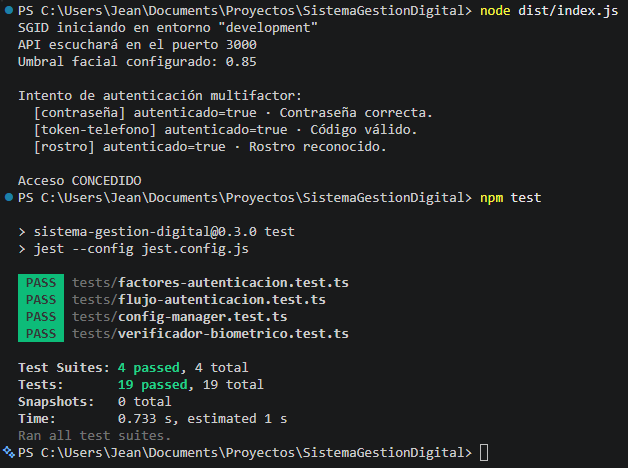

---

## ETAPA 4 — Builder

**Qué es:** construye un objeto complicado paso a paso, en vez de pasarle todos los datos de golpe a un constructor.

**En el proyecto:** la `CredencialDigital` (usuario, rol, permisos, factores,
vigencia) se arma con `CredencialDigitalBuilder`. El builder valida que no
falte nada y calcula la expiración con el Singleton. El director conoce la
receta de cada rol.

| Papel | Clase |
|---|---|
| Producto | `CredencialDigital` |
| Builder | `ConstructorCredencial` → `CredencialDigitalBuilder` |
| Director | `DirectorCredenciales` (recetas fijas), `DirectorCredencialesPorRol` (recetas del panel) |

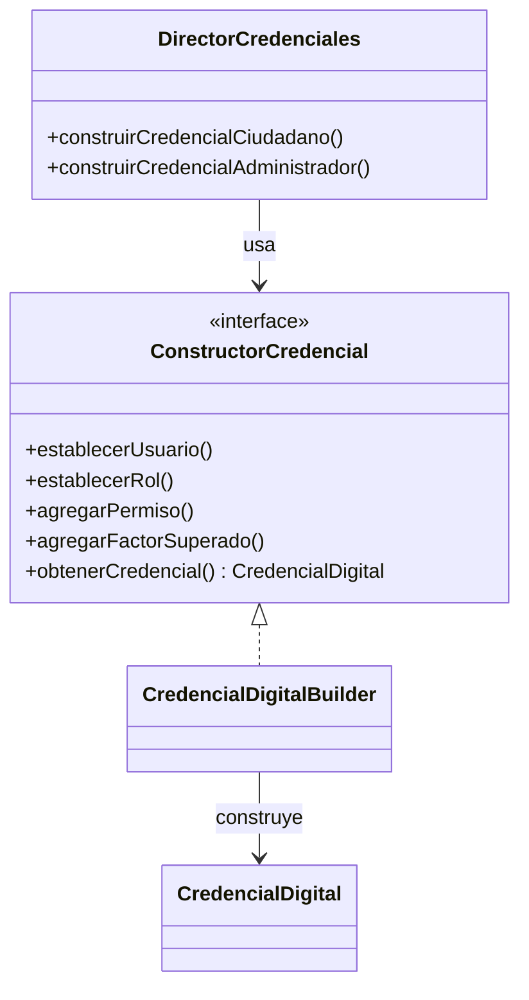

**Archivos:** `domain/credencial/credencial-digital.ts`, `application/credencial/*`

**Pruebas:** `tests/credencial-digital-builder.test.ts`, `tests/director-credenciales.test.ts`

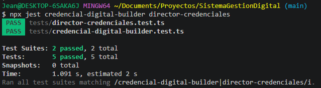

---

## ETAPA 5 — Adapter

**Qué es:** hace que dos piezas con formas distintas trabajen juntas, como un adaptador de enchufe.

**En el proyecto:** hay dos SDK de SMS incompatibles (uno usa `sendMessage()`
y el otro `enviarTexto()`, que además lanza errores). Cada adaptador los
traduce a la misma interfaz `enviar()`, y si un proveedor falla se usa el otro.

| Papel | Clase |
|---|---|
| Interfaz esperada | `EnviadorNotificaciones` |
| Clases externas | `SmsGlobalSDK`, `SmsLocalSDK` |
| Adaptadores | `AdaptadorSmsGlobal`, `AdaptadorSmsLocal` |

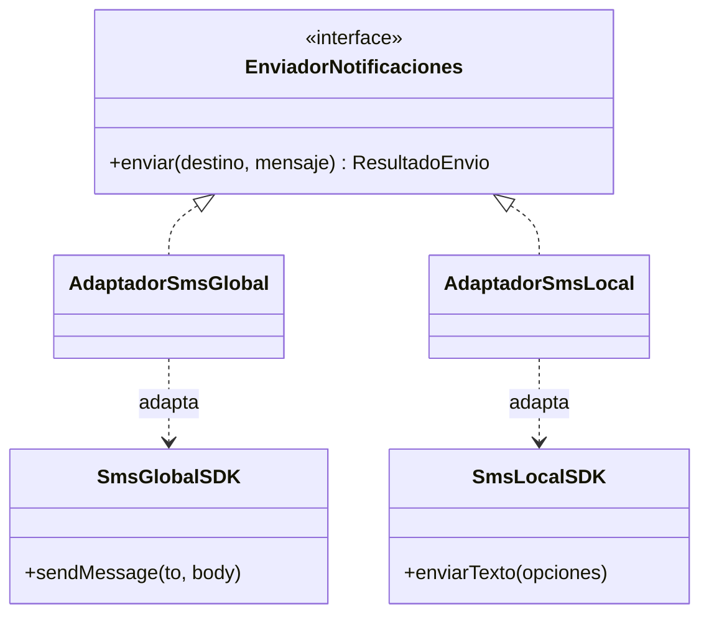

**Archivos:** `application/notificaciones/enviador-notificaciones.ts`, `infrastructure/notificaciones/*`

**Pruebas:** `tests/adaptadores-notificaciones.test.ts`

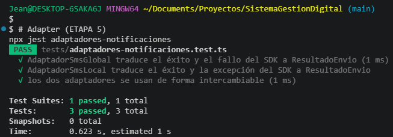

---

## ETAPA 6 — Bridge

**Qué es:** separa "qué se hace" de "cómo se hace", para que cada parte cambie sin afectar a la otra.

**En el proyecto:** el tipo de aviso (simple o urgente) va separado del canal
por donde se envía (SMS o correo). Cualquier tipo funciona con cualquier
canal, sin crear una clase por cada combinación. Se usa para avisar de cada
inicio de sesión.

| Papel | Clase |
|---|---|
| Abstracción | `Notificacion` → `NotificacionSimple`, `NotificacionUrgente` |
| Implementación | `EnviadorNotificaciones` → `AdaptadorSmsGlobal`, `AdaptadorSmsLocal`, `EnviadorCorreo` |

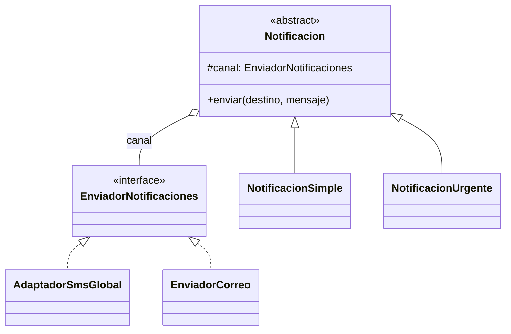

**Archivos:** `application/notificaciones/notificacion*.ts`, `infrastructure/notificaciones/enviador-correo.ts`

**Pruebas:** `tests/notificacion-bridge.test.ts`

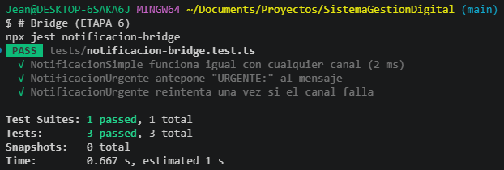

---

## ETAPA 7 — Composite

**Qué es:** trata igual a un elemento suelto y a un grupo de elementos, como archivos y carpetas.

**En el proyecto:** un rol es un árbol de permisos. Puede tener grupos
completos (`auditoria`) y permisos sueltos (`consultar-identidad`), y a los
dos se les pregunta lo mismo: `contiene()` y `listar()`. El administrador arma
los roles desde el panel.

| Papel | Clase |
|---|---|
| Componente | `NodoPermiso` |
| Hoja | `PermisoSimple` |
| Compuesto | `GrupoPermisos` |
| Árboles | `catalogoPermisos` (fijo), `GestorRoles` (editable) |

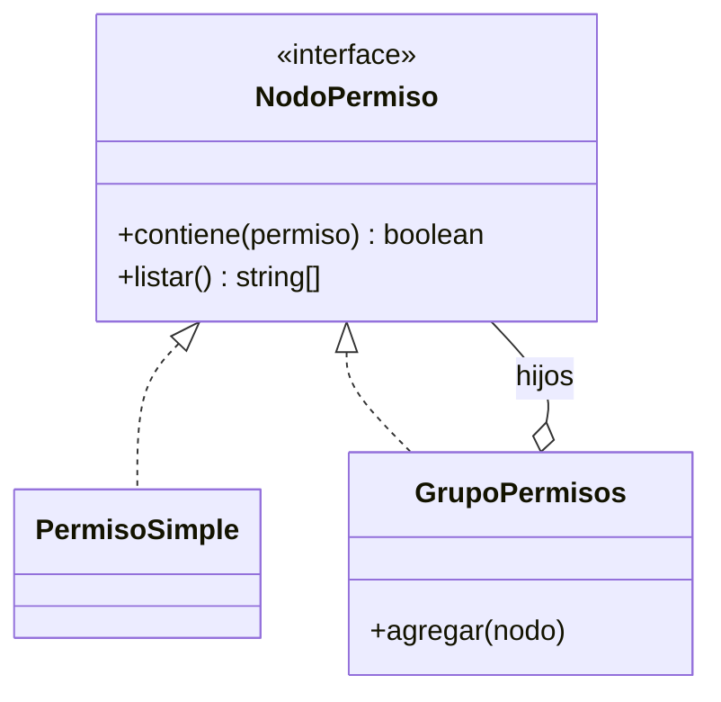

**Archivos:** `domain/permisos/*`, `application/permisos/*`

**Pruebas:** `tests/permisos-composite.test.ts`

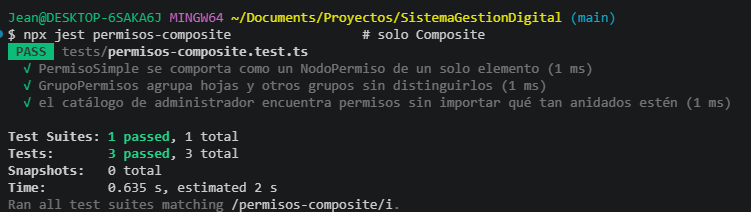

---

## ETAPA 8 — Decorator

**Qué es:** agrega funciones a un objeto envolviéndolo en capas, sin tocar su código.

**En el proyecto:** los flujos de autenticación se envuelven con capas que
agregan bitácora, auditoría permanente y bloqueo tras 3 fallos. El flujo de
adentro no se entera:
`Bitacora(Auditoria(LimiteIntentos(flujo)))`.

| Papel | Clase |
|---|---|
| Componente | `Autenticador` (lo cumple cualquier `FlujoAutenticacion`) |
| Decorador base | `AutenticadorDecorador` |
| Decoradores | `AutenticadorConBitacora`, `AutenticadorConLimiteIntentos`, `AutenticadorConAuditoria` |

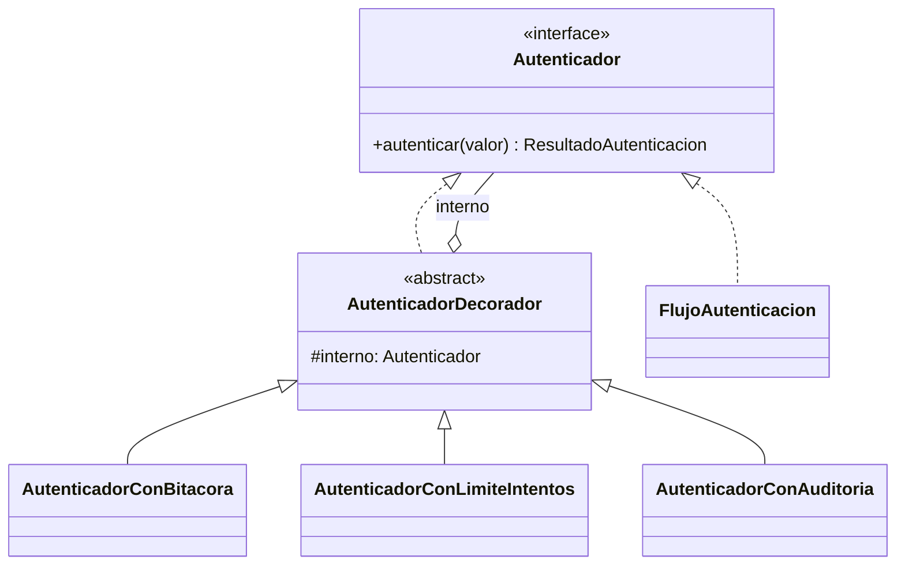

**Archivos:** `application/auth/autenticador*.ts`

**Pruebas:** `tests/autenticador-decoradores.test.ts`

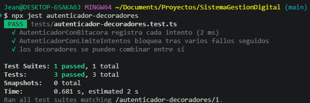

---

## ETAPA 9 — Flyweight

**Qué es:** ahorra memoria compartiendo un mismo objeto entre muchos que lo necesitan igual.

**En el proyecto:** miles de ciudadanos tienen cédula, pero "qué es una cédula
y cómo se valida" es igual para todos. `FabricaTiposDocumento` crea cada tipo
(CC, CE, PA, TI) una sola vez y lo comparte. Se usa al registrarse para
validar el número.

| Papel | Clase |
|---|---|
| Flyweight (compartido) | `TipoDocumento` |
| Fábrica | `FabricaTiposDocumento` |
| Contexto (propio de cada persona) | `DocumentoIdentidad` |

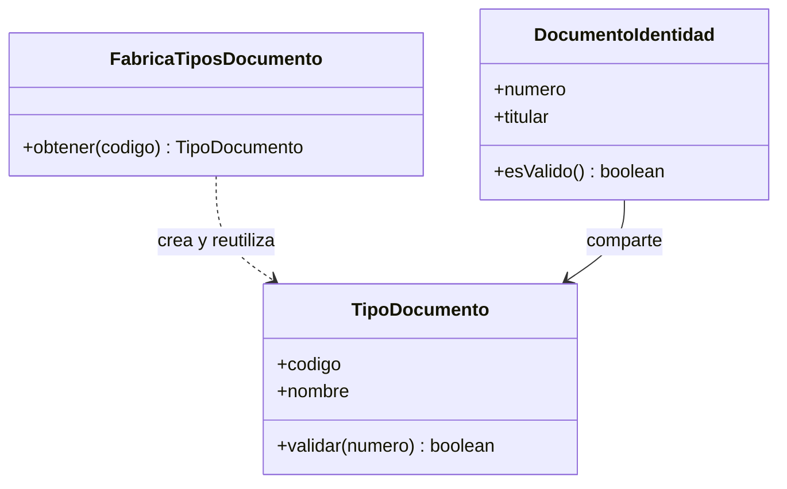

**Archivos:** `domain/documentos/*`, `application/documentos/fabrica-tipos-documento.ts`

**Pruebas:** `tests/tipos-documento-flyweight.test.ts`

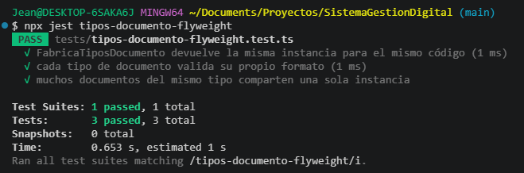

---

## ETAPA 10 — Proxy

**Qué es:** pone un intermediario delante de un objeto para controlar quién puede usarlo y cuándo.

**En el proyecto:** `RepositorioIdentidadProxy` se pone delante del
repositorio real y solo deja pasar la consulta si la credencial tiene el
permiso `consultar-identidad`. Lo usan el perfil de la persona y los
servicios conectados cuando piden sus datos.

| Papel | Clase |
|---|---|
| Sujeto | `RepositorioIdentidad` |
| Sujetos reales | `RepositorioIdentidadMemoria`, `RepositorioUsuariosArchivo` |
| Proxy | `RepositorioIdentidadProxy` |

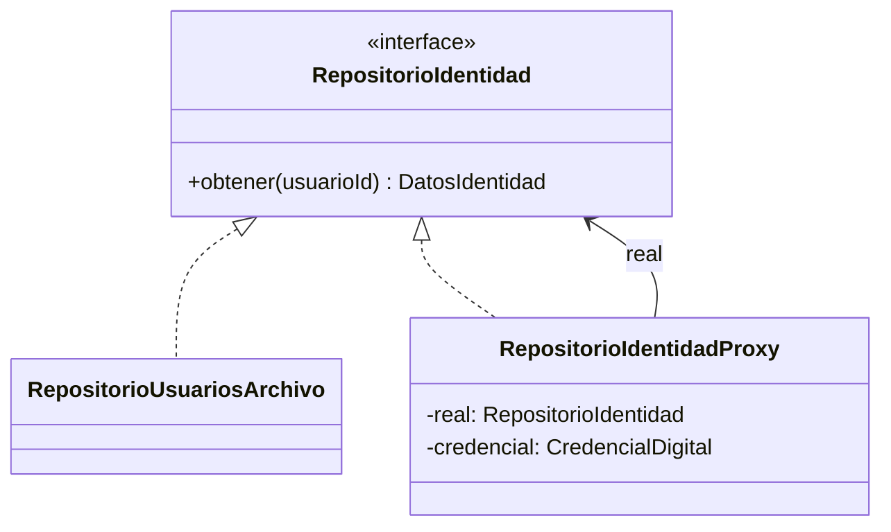

**Archivos:** `domain/identidad/repositorio-identidad.ts`, `application/identidad/repositorio-identidad-proxy.ts`, `infrastructure/persistencia/repositorio-usuarios-archivo.ts`

**Pruebas:** `tests/repositorio-identidad-proxy.test.ts`

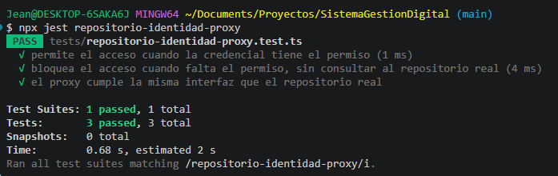

---

## ETAPA 11 — Iniciar sesión con SGID, seguridad y administración

En esta etapa se completó el sistema **sin cambiar las clases de los
patrones**: todo lo nuevo los usa o los extiende (un creador, un decorador y
un director más).

**Lo que se agregó:**

- Registro e inicio de sesión de varias personas: cada una elige dos de sus tres factores, en el orden que quiera.
- Panel de administración: roles y permisos, usuarios, servicios conectados y auditoría.
- "Iniciar sesión con SGID" para los servicios del Estado, con un servicio de prueba (una alcaldía ficticia).

### Cómo un servicio usa SGID

Es el flujo estándar de OAuth2 *authorization code*, el mismo de "Iniciar sesión con Google":

1. El administrador conecta el servicio y le entrega su `client_id` y `client_secret`.
2. El servicio manda a la persona a `/autorizar`.
3. La persona inicia sesión en SGID y acepta compartir sus datos.
4. SGID la devuelve al servicio con un código de un solo uso.
5. El servicio canjea el código por un token y lee la identidad.

| Ruta | Para qué |
|---|---|
| `GET /autorizar?client_id&redirect_uri&state` | La persona inicia sesión y da su consentimiento |
| `POST /api/gov/v1/oauth/token` | El servicio canjea el código por un token |
| `GET /api/gov/v1/usuario` | El servicio lee nombre, documento y factores verificados |

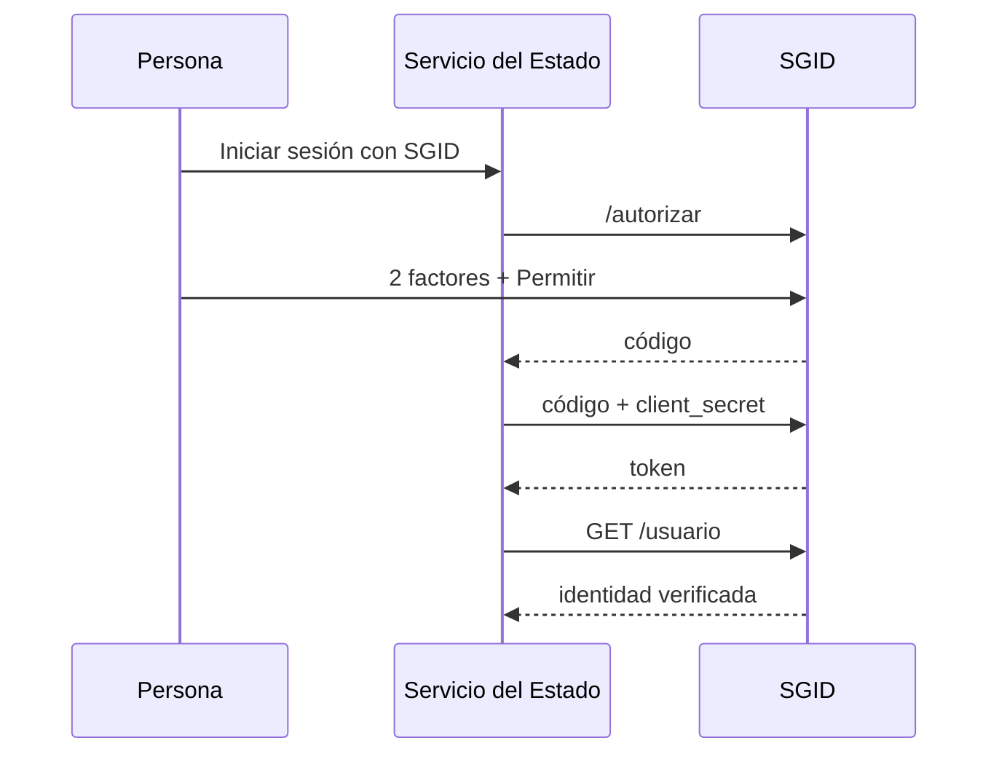

### Seguridad

| Control | Cómo |
|---|---|
| Contraseñas y secretos | Hash scrypt con sal; nunca se guardan en claro |
| Datos sensibles | Documento, teléfono, correo y rostro cifrados con AES-256-GCM |
| Sesión | Token JWT firmado, con vencimiento y revocación al salir |
| Fuerza bruta | 3 intentos por factor; códigos de un solo uso |
| Permisos | El rol lo asigna el servidor y se revisa en cada petición |
| Auditoría | Cada registro guarda el hash del anterior: si alguien edita el archivo, se detecta |
| Servicios conectados | Su token solo sirve para leer la identidad y se corta al desconectarlos |

**Para un uso real faltaría:** HTTPS, un proveedor de SMS real (hoy hay un
teléfono simulado), una base de datos en vez de archivos JSON y prueba de vida
en el rostro.

---

## ETAPA 12 — Strategy

**Qué es:** define una familia de algoritmos intercambiables y deja que el objeto que los usa cambie de uno a otro sin saber cuál está usando.

**En el proyecto:** la contraseña que se pide al registrarse depende del rol
con el que queda la persona. El administrador controla todo el sistema, así
que se le exige más (12 caracteres con mayúsculas, minúsculas, números y un
símbolo); al ciudadano, 8 caracteres con letras y números. `ServicioUsuarios`
pide la política con `politicaPara(rol)` y solo llama a `cumple()`. Agregar
otra regla (por ejemplo, para un rol de auditor) es agregar una clase, sin
tocar el registro. La pantalla de registro muestra la regla que toca.

| Papel | Clase |
|---|---|
| Estrategia | `PoliticaContrasena` |
| Estrategias concretas | `PoliticaContrasenaCiudadano`, `PoliticaContrasenaAdministrador` |
| Contexto | `ServicioUsuarios` (al registrar) |

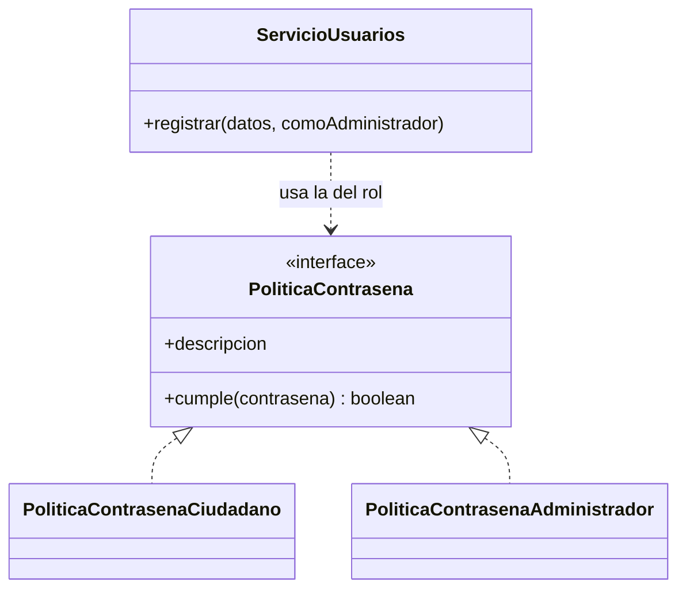

**Diferencia con Bridge (ETAPA 6):** en Bridge varían los dos lados (tipo de
aviso y canal). Aquí solo varía el algoritmo y quien lo usa es siempre el mismo.

**Archivos:** `application/usuarios/politica-contrasena.ts`, `application/usuarios/servicio-usuarios.ts`

**Cómo verlo:** en el primer arranque, el formulario pide la contraseña del
administrador con la regla estricta; después, los ciudadanos se registran con
la regla básica.

---

## ETAPA 13 — Template Method

**Qué es:** una clase base fija los pasos de un procedimiento y su orden, y deja que las subclases redefinan solo algunos de esos pasos.

**En el proyecto:** exportar la auditoría siempre sigue el mismo
procedimiento, definido en `exportar()`:

1. Dejar constancia de la descarga en la propia auditoría.
2. Verificar la cadena de hashes.
3. Escribir el encabezado, una fila por registro y el pie.
4. Armar el nombre del archivo con la fecha.

Los pasos 1, 2 y 4 son iguales siempre. El paso 3 lo escribe cada formato:
`ExportadorJson` (como lo descargaba el panel) y `ExportadorCsv` (para abrir
en Excel, protegido contra fórmulas). `separador()` y `pie()` son *ganchos*:
tienen un valor por defecto y el formato los cambia solo si lo necesita.

| Papel | Clase |
|---|---|
| Clase abstracta (método plantilla) | `ExportadorAuditoria.exportar()` |
| Pasos abstractos | `encabezado()`, `fila()` |
| Ganchos | `separador()`, `pie()` |
| Clases concretas | `ExportadorJson`, `ExportadorCsv` |

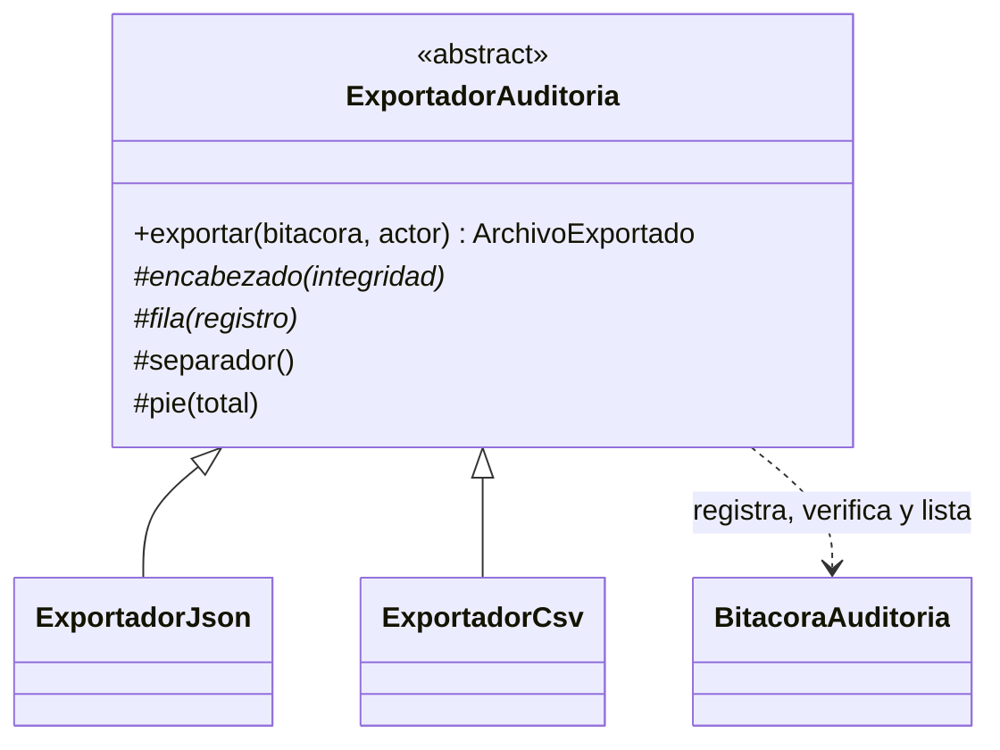

**Diferencia con Strategy (ETAPA 12):** Strategy cambia el algoritmo completo
usando otro objeto (composición). Template Method mantiene el algoritmo y
cambia solo algunos pasos mediante subclases (herencia).

**Archivos:** `application/auditoria/exportador-auditoria.ts`, `web/rutas/rutas-admin.ts`

**Cómo verlo:** en el panel de administración, pestaña Auditoría, los botones
**CSV** y **JSON** descargan la bitácora (`GET /api/admin/auditoria/exportar?formato=csv`).

---

## Autor

Keanon Jeanpierre Angarita Olarte
